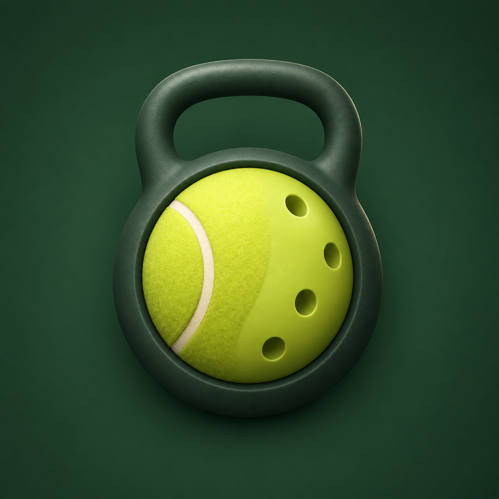

# CourtFit

Plan adult strength work around tennis, understand an exercise, or adapt a session to your available time and equipment. CourtFit provides 200 anatomical exercise references with English, Portuguese and Spanish teaching, native dose units and exact video links from a verified pinned catalog source.

Public plugin source: [davidmosiah/courtfit-plugin](https://github.com/davidmosiah/courtfit-plugin). Product website: [courtfit.app](https://courtfit.app). This repository contains only the plugin package; public source availability does not establish marketplace approval or installation.

The server checks confirmed equipment, supports, capabilities, experience, match timing and modeled session duration. It does not access the CourtFit iPhone app, Apple Health, purchases or past workouts, and it does not synchronize plans. This catalog is a pinned source snapshot; it is not a claim about the catalog in the currently released iPhone app.

## Setup and use

This is an Agent Plugin: `plugin.json`, `mcp.json` and `skills/tennis-training/SKILL.md` live at the package root. A compatible host discovers the skill and connects to the public HTTPS Streamable HTTP MCP endpoint in `mcp.json`. No API key, account, local executable or secret is required by this server. Review your host's connection and data controls before enabling it.

Cursor documents support for the Agent Plugins format. Grok Bot documents installing plugins through its plugin catalog. Availability of this particular plugin in that catalog is subject to marketplace review and host discovery; it has not been established by creating this package. A shared Grok Bot template alone does not install a custom MCP server. See [distribution](DISTRIBUTION.md).

The tools are `courtfit_search_exercises`, `courtfit_show_exercise` and `courtfit_show_session`. For an exercise explanation, ask naturally in your preferred language. For a personalized session, supply adult status, comfortable exercise without current pain/restriction, experience, time, exact equipment/supports and tennis/match timing. Do not include medical histories or identifying information.

## Examples

- English: “Explain the goblet squat and show its anatomical video.”
- Português: “Sou adulto iniciante, sem dor ou restrição. Tenho 25 minutos, um par de halteres, chão e apoio acolchoado para os joelhos. Não tenho banco nem rack e não jogo partida nas próximas 24 horas. Monte uma sessão simples.”
- Español: “Tengo el mismo equipo, pero ahora solo dispongo de 8 minutos. Adapta la sesión y explica el cambio.”

## Videos and host support

Each reference returned by the MCP server includes complete text teaching, an exact anatomical MP4 link and a poster. A compatible MCP Apps host may render the interactive player. When you ask for a video and the host supports native attachments, the assistant can fetch and attach that original admitted MP4 without transforming it: one for an exercise explanation, at most three relevant demonstrations for a session, with exact links for the rest. This is on-demand display, not a bulk media export. The host may process and retain the attachment under its policies.

In private Grok Bot review, a native anatomical MP4 attachment played from 0 to 6.016 seconds. The MCP Apps widget and Markdown poster did not render in that reviewed surface. This observation does not prove marketplace installation or support across all hosts/versions. If attachments or the player are unavailable, the assistant should provide the returned text instructions and clearly labeled video links. It must never claim playback or a completed workout without observing it.

Videos are demonstrations, not timers. Session duration is an estimate including recovery, side changes, transitions and a 120-second preparation/finish buffer. Preserve seconds, repetitions, distance and side basis exactly. Only reductions of the catalog dose are permitted; no precise load prescriptions.

## Safety and privacy

Adult general fitness education only. CourtFit does not diagnose, treat injury, prescribe rehabilitation or provide medical clearance. A minor, current pain, injury or professional restriction is outside personalized training scope. Stop the provoking movement and seek qualified individual guidance when needed.

The connected server processes structured exercise/session fields in memory without storing workout history. The host (Grok/xAI or Cursor) processes your conversation and tool use under its own policies, separate from CourtFit. The infrastructure still receives normal network requests; “stateless” does not mean no network metadata. See [privacy boundaries](PRIVACY.md).

## Contents and rights

`catalog-reference.json` records all 200 IDs, localized names, exact doses, eligibility and hash-addressed media mappings for audit. Runtime search remains authoritative; the skill must not substitute a stale local catalog for server results. `catalog-provenance.json` identifies the source snapshots and hashes. No MP4/JPG files, native app code, credentials, app bindings or deployment configuration are included.

The original plugin code and documentation listed in [LICENSE](LICENSE) are MIT licensed. See [rights notice](RIGHTS.md) for the explicit branding, catalog, provenance and media exclusions. The owner authorized this separate public plugin repository and marketplace submission. The multi-host privacy policy is live in English, Portuguese and Spanish. Publisher application/terms, review and actual marketplace installation remain separate steps; public source and private-host QA are not marketplace approval.
